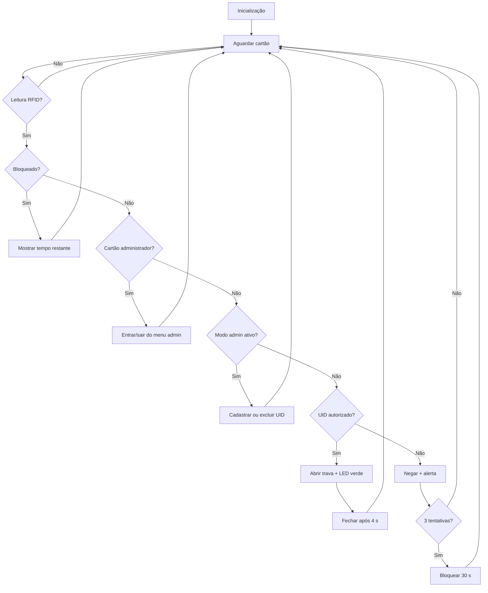

# SmartAccess 🔐
## Sistema inteligente de controle de acesso com Arduino e RFID

**Guia de implementação para projeto final de Sistemas Embarcados**  
**Equipe:** 2 integrantes  
**Plataforma:** Arduino Uno  
**Data prevista da apresentação:** 30/11/2026  
**Natureza:** protótipo didático com maquete; não usar como fechadura de segurança real.

> **Nota sobre o enunciado:** as exigências abaixo foram recuperadas da conversa sobre o PDF da disciplina. Não foi possível reabrir integralmente o PDF original durante a criação deste arquivo; por isso, confirmem os critérios e a data no documento do professor. A proposta foi desenhada para contemplar entradas digitais, saídas digitais, display, situação-problema e recurso novo.

---

## 1. Resumo executivo

O SmartAccess é um protótipo de controle de acesso para laboratórios, salas técnicas ou ambientes restritos. Um cartão RFID é aproximado do leitor RC522; o Arduino consulta a lista de identificadores autorizados, informa o resultado no LCD, movimenta uma pequena trava com servo motor e sinaliza por LED e buzzer. Após três tentativas inválidas consecutivas, o sistema bloqueia novas leituras por 30 segundos. Um cartão administrador possibilita cadastrar e remover cartões, com registros persistidos na EEPROM do Arduino.

**Objetivo principal:** demonstrar integração de entradas, saídas, comunicação SPI/I2C, máquinas de estados, temporizadores sem bloqueio e persistência de dados, em um projeto realizável por uma dupla.

### 1.1 Situação-problema

Chaves convencionais são pouco práticas para representar permissões individuais, e a perda de chaves pode exigir troca de fechaduras. O projeto oferece uma demonstração de controle eletrônico de permissões baseado na leitura de cartões.

### 1.2 Escopo mínimo obrigatório (MVP)

1. Identificar um cartão RFID.
2. Verificar se está autorizado.
3. Liberar ou negar acesso e apresentar a mensagem no LCD.
4. Movimentar o servo para abrir e fechar a trava.
5. Acionar LED e buzzer de maneira coerente.

### 1.3 Funcionalidades de diferenciação

- Bloqueio de 30 segundos após três tentativas inválidas consecutivas.
- Cartão administrador com modo de cadastro e exclusão.
- Armazenamento de cartões na EEPROM, preservando cadastros sem energia.
- Controle de tempo com `millis()`, sem travar a aplicação com `delay()`.
- Comunicação RFID via **SPI** e LCD via **I2C**.

> **Recurso novo exigido pela disciplina:** antes da entrega, confirmem que ao menos um destes recursos **não foi utilizado anteriormente pela dupla**: RFID/RC522, SPI, EEPROM, servo ou outra técnica efetivamente implementada. Não afirmar inovação apenas por combinar componentes conhecidos.

---

## 2. Como o sistema funciona

### 2.1 Cenário normal

1. LCD exibe `SMARTACCESS / APROXIME CARTAO`.
2. Usuário aproxima cartão compatível de 13,56 MHz ao RC522.
3. RC522 lê o **UID** do cartão e envia ao Arduino por SPI.
4. Arduino procura o UID na lista autorizada, mantida em EEPROM.
5. Se autorizado: LED verde acende, buzzer confirma, LCD informa `ACESSO LIBERADO` e servo move a trava.
6. Após cerca de 4 segundos, servo retorna à posição fechada e LCD volta ao estado inicial.
7. Se não autorizado: LED vermelho e buzzer alertam; porta permanece fechada.
8. Após três cartões inválidos lidos consecutivamente, o sistema entra em bloqueio temporário de 30 segundos.

### 2.2 Administração

- Um **cartão administrador** (UID fixo no código, não contado como usuário normal) abre o menu de manutenção.
- O modo administrativo começa em **CADASTRAR**.
- O botão físico alterna entre **CADASTRAR** e **EXCLUIR**.
- Aproxime outro cartão para executar a opção selecionada.
- Aproxime novamente o cartão administrador para sair do menu.
- A administração expira após 15 segundos sem ação.
- O cartão administrador **não pode ser apagado** pelo menu.

### 2.3 Fluxograma resumido



---

## 3. Materiais e ferramentas

| Quantidade | Item | Finalidade | Observações |
|---:|---|---|---|
| 1 | Arduino Uno R3 ou compatível | Controlador | USB para programação |
| 1 | Módulo MFRC522 / RC522 | Leitor RFID | Alimentação **3,3 V** |
| 2–3 | Cartões ou chaveiros MIFARE/compatíveis, 13,56 MHz | Administrador, autorizado e não autorizado | Escolher cartões **com UID de 4 bytes para esta versão do código** |
| 1 | LCD 16×2 com adaptador I2C | Interface | Endereço comum 0x27 ou 0x3F |
| 1 | Microservo SG90 | Trava da maquete | Alimentação 5 V adequada |
| 1 | LED verde + resistor 220–330 Ω | Acesso autorizado | |
| 1 | LED vermelho + resistor 220–330 Ω | Acesso negado | |
| 1 | Buzzer ativo de 5 V de baixo consumo | Avisos | Conferir consumo; se alto, usar transistor |
| 1 | Botão de pressão | Alternar cadastro/exclusão | `INPUT_PULLUP` |
| 1 | Protoboard + jumpers | Montagem | |
| 1 | Fonte regulada 5 V para servo | Alimentação | **GND compartilhado com Arduino** |
| 1 | Conversor de nível lógico 5 V → 3,3 V ou divisores corretamente dimensionados | Proteger sinais do RC522 | Aplicar às linhas Uno→RC522 |
| 1 | Estrutura de MDF ou papelão rígido | Maquete de porta | Trava leve, sem esforço excessivo |

**Ferramentas:** notebook, cabo USB, Arduino IDE 2.x, régua, fita dupla face ou cola, chave de precisão e multímetro (recomendado).

**Custo:** variável conforme o que a dupla já possui; comprar apenas os itens faltantes e confirmar preços localmente. A maior economia é reutilizar o Arduino, protoboard e componentes básicos do laboratório.

---

## 4. Arquitetura e mapa de ligações

### 4.1 Pinos propostos para o Arduino Uno

| Componente | Terminal do módulo | Arduino Uno | Observação |
|---|---|---|---|
| RC522 | SDA/SS | D10 | SPI chip select; nível 3,3 V |
| RC522 | SCK | D13 | SPI clock; nível 3,3 V |
| RC522 | MOSI | D11 | SPI dados; nível 3,3 V |
| RC522 | MISO | D12 | Sinal 3,3 V → entrada Uno, normalmente reconhecido como HIGH |
| RC522 | RST | D9 | Adaptar nível para 3,3 V |
| RC522 | 3.3V | 3.3V | **Nunca ligar a 5 V** |
| RC522 | GND | GND | Terra comum |
| LCD I2C | SDA | A4 | Dados I2C |
| LCD I2C | SCL | A5 | Clock I2C |
| LCD I2C | VCC | 5V* | *Confirmar especificação do módulo LCD* |
| LCD I2C | GND | GND | |
| Servo SG90 | Sinal | D3 | PWM de controle da posição |
| Servo SG90 | VCC | Fonte externa 5 V | Não depender da USB se houver quedas de tensão |
| Servo SG90 | GND | GND da fonte e Arduino | Terra em comum obrigatório |
| LED verde | Ânodo por resistor | D5 | Cátodo ao GND |
| LED vermelho | Ânodo por resistor | D6 | Cátodo ao GND |
| Buzzer | Sinal positivo | D4 | Buzzer ativo de baixo consumo |
| Buzzer | Negativo | GND | |
| Botão | Um lado | D7 | `INPUT_PULLUP` |
| Botão | Outro lado | GND | Acionado = LOW |

**Atenção ao RC522:** o módulo opera em 3,3 V. O Arduino Uno opera em lógica de 5 V. Não liguem D9, D10, D11 e D13 diretamente aos pinos de sinal do RC522 sem verificar a tolerância do módulo e realizar a adaptação de nível. Um conversor adequado é a solução recomendada. Não alimentar o servo pelo pino de 3,3 V.

### 4.2 Diagrama lógico (não substitui esquema elétrico)

```text
      Cartão RFID
           |
      RC522 [SPI]
           |
           v
     +-------------+      I2C       +--------------+
     | ARDUINO UNO |--------------->| LCD 16x2     |
     |             |                +--------------+
     | EEPROM      |------ D3 -----> Servo / Trava
     | Controle    |------ D5 -----> LED verde
     | de estados  |------ D6 -----> LED vermelho
     |             |------ D4 -----> Buzzer
     |             |<----- D7 ------ Botão admin
     +-------------+
```

### 4.3 Regras para montagem segura

1. Desligar todas as fontes antes de trocar fios.
2. Conferir polaridade, VCC e GND de cada módulo com a ficha do fabricante.
3. Nunca usar RC522 com alimentação de 5 V.
4. Usar fonte estável separada para servo e unir os GNDs.
5. Não deixar o servo em esforço permanente contra uma trava rígida: usar maquete leve e ajustar ângulos.
6. Não ligar cargas de alta potência diretamente aos pinos do Arduino.
7. Testar individualmente cada módulo antes de conectar tudo.

---

## 5. Software e bibliotecas

1. Instalar **Arduino IDE**.
2. Selecionar placa **Arduino Uno** e a porta USB correspondente.
3. Em **Gerenciar Bibliotecas**, instalar:
   - `MFRC522` (biblioteca para o RC522);
   - `LiquidCrystal I2C` (verificar a API `init()`, `backlight()` e `setCursor()` da versão instalada);
   - `Servo` (geralmente disponível no ecossistema Arduino).
4. `SPI`, `Wire` e `EEPROM` fazem parte do ambiente Arduino AVR/Uno.
5. Ajustar o endereço do LCD para `0x27` ou `0x3F` conforme o seu módulo.
6. Abrir Monitor Serial em **9600 baud** para identificar o UID do cartão administrador.

> O código abaixo é uma **implementação de referência**, não um firmware testado nesta conversa em hardware real. Confiram versão das bibliotecas e o comportamento físico dos componentes; adaptem os ângulos do servo à maquete.

---

## 6. Firmware de referência (`SmartAccess.ino`)

**Limitações intencionais para manter o projeto simples:** apenas cartões com UID de **4 bytes**; no máximo 15 cartões cadastrados; o UID é uma identificação didática, **não uma autenticação criptográfica segura**; o bloqueio é volátil e reiniciar o Arduino reinicia o contador.

```cpp
#include <SPI.h>
#include <MFRC522.h>
#include <Wire.h>
#include <LiquidCrystal_I2C.h>
#include <Servo.h>
#include <EEPROM.h>

const byte PIN_SS = 10;
const byte PIN_RST = 9;
const byte PIN_SERVO = 3;
const byte PIN_BUZZER = 4;
const byte PIN_LED_OK = 5;
const byte PIN_LED_FAIL = 6;
const byte PIN_BUTTON = 7;

const byte MAX_CARDS = 15;
const byte EEPROM_MAGIC = 0xA7;
const int ADDR_MAGIC = 0;
const int ADDR_COUNT = 1;
const int ADDR_CARDS = 2;

const unsigned long OPEN_MS = 4000UL;
const unsigned long BLOCK_MS = 30000UL;
const unsigned long ADMIN_MS = 15000UL;
const unsigned long MESSAGE_MS = 1200UL;
const unsigned long DEBOUNCE_MS = 50UL;

const int SERVO_CLOSED = 0;
const int SERVO_OPEN = 90;

// SUBSTITUIR pelo UID real do cartão administrador, impresso no Serial.
const byte ADMIN_UID[4] = {0xDE, 0xAD, 0xBE, 0xEF};

MFRC522 reader(PIN_SS, PIN_RST);
LiquidCrystal_I2C lcd(0x27, 16, 2);
Servo lockServo;

enum State { IDLE, OPEN, DENIED, BLOCKED, ADMIN };
State state = IDLE;

byte invalidAttempts = 0;
unsigned long stateSince = 0;
unsigned long adminLastActivity = 0;
unsigned long lastButtonChange = 0;
bool lastButtonRead = HIGH;
bool stableButton = HIGH;
bool adminRemoveMode = false;

void show(const char* line1, const char* line2) {
  lcd.clear();
  lcd.setCursor(0, 0);
  lcd.print(line1);
  lcd.setCursor(0, 1);
  lcd.print(line2);
}

void setState(State newState) {
  state = newState;
  stateSince = millis();
}

void signalAccess(bool allowed) {
  digitalWrite(PIN_LED_OK, allowed ? HIGH : LOW);
  digitalWrite(PIN_LED_FAIL, allowed ? LOW : HIGH);
  digitalWrite(PIN_BUZZER, HIGH);
}

void clearSignals() {
  digitalWrite(PIN_LED_OK, LOW);
  digitalWrite(PIN_LED_FAIL, LOW);
  digitalWrite(PIN_BUZZER, LOW);
}

bool sameUid(const byte* a, const byte* b) {
  for (byte i = 0; i < 4; i++) {
    if (a[i] != b[i]) return false;
  }
  return true;
}

byte cardCount() {
  byte count = EEPROM.read(ADDR_COUNT);
  return count <= MAX_CARDS ? count : 0;
}

void initializeStorage() {
  if (EEPROM.read(ADDR_MAGIC) != EEPROM_MAGIC ||
      EEPROM.read(ADDR_COUNT) > MAX_CARDS) {
    EEPROM.update(ADDR_MAGIC, EEPROM_MAGIC);
    EEPROM.update(ADDR_COUNT, 0);
  }
}

void readStoredUid(byte index, byte* uid) {
  int base = ADDR_CARDS + (int)index * 4;
  for (byte i = 0; i < 4; i++) uid[i] = EEPROM.read(base + i);
}

int findCard(const byte* uid) {
  byte stored[4];
  for (byte idx = 0; idx < cardCount(); idx++) {
    readStoredUid(idx, stored);
    if (sameUid(uid, stored)) return idx;
  }
  return -1;
}

bool addCard(const byte* uid) {
  if (sameUid(uid, ADMIN_UID) || findCard(uid) >= 0) return false;
  byte count = cardCount();
  if (count >= MAX_CARDS) return false;
  int base = ADDR_CARDS + (int)count * 4;
  for (byte i = 0; i < 4; i++) EEPROM.update(base + i, uid[i]);
  EEPROM.update(ADDR_COUNT, count + 1);
  return true;
}

bool removeCard(const byte* uid) {
  int index = findCard(uid);
  if (index < 0) return false;
  byte count = cardCount();
  byte last[4];
  readStoredUid(count - 1, last);
  int base = ADDR_CARDS + index * 4;
  for (byte i = 0; i < 4; i++) EEPROM.update(base + i, last[i]);
  EEPROM.update(ADDR_COUNT, count - 1);
  return true;
}

void showAdmin() {
  if (adminRemoveMode) show("ADMIN: EXCLUIR", "Passe o cartao");
  else show("ADMIN: CADASTRO", "Passe o cartao");
}

void enterIdle() {
  setState(IDLE);
  clearSignals();
  lockServo.write(SERVO_CLOSED);
  show("SMARTACCESS", "Aproxime cartao");
}

void processButton() {
  bool reading = digitalRead(PIN_BUTTON);
  if (reading != lastButtonRead) lastButtonChange = millis();
  if (millis() - lastButtonChange >= DEBOUNCE_MS && reading != stableButton) {
    stableButton = reading;
    if (stableButton == LOW && state == ADMIN) {
      adminRemoveMode = !adminRemoveMode;
      adminLastActivity = millis();
      showAdmin();
    }
  }
  lastButtonRead = reading;
}

void printUid(const byte* uid) {
  Serial.print("UID: ");
  for (byte i = 0; i < 4; i++) {
    if (uid[i] < 0x10) Serial.print('0');
    Serial.print(uid[i], HEX);
    if (i < 3) Serial.print(' ');
  }
  Serial.println();
}

void processCard(const byte* uid) {
  if (sameUid(uid, ADMIN_UID)) {
    if (state == ADMIN) {
      enterIdle();
    } else {
      adminRemoveMode = false;
      adminLastActivity = millis();
      setState(ADMIN);
      clearSignals();
      showAdmin();
    }
    return;
  }

  if (state == ADMIN) {
    bool success = adminRemoveMode ? removeCard(uid) : addCard(uid);
    Serial.println(success ? "Alteracao efetuada" : "Sem alteracao");
    adminLastActivity = millis();
    show(success ? "REGISTRO SALVO" : "SEM ALTERACAO", "Confira cadastro");
    // A tela volta para o menu na proxima iteracao.
    return;
  }

  if (findCard(uid) >= 0) {
    invalidAttempts = 0;
    setState(OPEN);
    lockServo.write(SERVO_OPEN);
    signalAccess(true);
    show("ACESSO LIBERADO", "Porta aberta");
  } else {
    invalidAttempts++;
    if (invalidAttempts >= 3) {
      invalidAttempts = 0;
      setState(BLOCKED);
      signalAccess(false);
      show("BLOQUEADO", "Aguarde 30s");
    } else {
      setState(DENIED);
      signalAccess(false);
      show("ACESSO NEGADO", "Cartao invalido");
    }
  }
}

void setup() {
  pinMode(PIN_LED_OK, OUTPUT);
  pinMode(PIN_LED_FAIL, OUTPUT);
  pinMode(PIN_BUZZER, OUTPUT);
  pinMode(PIN_BUTTON, INPUT_PULLUP);
  clearSignals();

  Serial.begin(9600);
  SPI.begin();
  reader.PCD_Init();
  lcd.init();
  lcd.backlight();
  lockServo.attach(PIN_SERVO);
  lockServo.write(SERVO_CLOSED);
  initializeStorage();
  enterIdle();
  Serial.println("SmartAccess iniciado. Aproxime cartao para ler UID.");
}

void loop() {
  unsigned long now = millis();
  processButton();

  if (state == OPEN && now - stateSince >= OPEN_MS) enterIdle();
  if (state == DENIED && now - stateSince >= MESSAGE_MS) enterIdle();
  if (state == BLOCKED && now - stateSince >= BLOCK_MS) enterIdle();
  if (state == ADMIN && now - adminLastActivity >= ADMIN_MS) enterIdle();

  // Desliga sinais sonoros/visuais apos um pulso curto.
  if ((state == OPEN || state == DENIED || state == BLOCKED) &&
      now - stateSince >= 250UL) clearSignals();

  if (state != IDLE && state != ADMIN) return;
  if (!reader.PICC_IsNewCardPresent()) return;
  if (!reader.PICC_ReadCardSerial()) return;

  if (reader.uid.size == 4) {
    byte uid[4];
    for (byte i = 0; i < 4; i++) uid[i] = reader.uid.uidByte[i];
    printUid(uid);
    processCard(uid);
  } else {
    Serial.println("UID nao suportado: usar cartao com UID de 4 bytes.");
    if (state != ADMIN) {
      setState(DENIED);
      signalAccess(false);
      show("UID INCOMPATIVEL", "Use UID 4 bytes");
    } else {
      adminLastActivity = now;
      show("UID INCOMPATIVEL", "Use UID 4 bytes");
    }
  }

  reader.PICC_HaltA();
  reader.PCD_StopCrypto1();
}
```

### 6.1 Ajuste importante do cartão administrador

1. Enviar o sketch ao Arduino com `ADMIN_UID` provisório.
2. Abrir o Monitor Serial (9600 baud).
3. Aproximar o cartão escolhido como administrador.
4. Copiar os quatro bytes exibidos. Exemplo: `UID: 12 AB 34 CD`.
5. Substituir a constante por:

```cpp
const byte ADMIN_UID[4] = {0x12, 0xAB, 0x34, 0xCD};
```

6. Compilar e enviar novamente.
7. Aproximar o administrador: LCD deve exibir o modo de cadastro.
8. Cadastrar pelo menos **um cartão diferente**, que será o cartão autorizado do teste.

### 6.2 Notas sobre o comportamento do firmware

- **Admin:** cartão admin pode entrar/sair do menu quando em `IDLE` ou `ADMIN`.
- **Durante abertura/negação/bloqueio:** novas leituras são ignoradas até acabar o estado; o admin não contorna o bloqueio ativo.
- **Avisos do menu:** após cadastrar/excluir, a mensagem de resultado permanece na tela até outra ação ou expiração do menu; o sistema continua no modo `ADMIN`.
- **UIDs diferentes de 4 bytes:** são rejeitados neste protótipo. Se o kit entregue incluir cartões de 7 bytes, será necessário adaptar o armazenamento e as comparações antes do teste.
- **Acesso:** a liberação depende apenas da lista de UID. Isso é vulnerável a cópia de identificadores e não serve para proteção real.
- **Buzzer:** o código pressupõe buzzer **ativo**, que soa quando D4 está em HIGH.
- **EEPROM:** `EEPROM.update()` evita gravações desnecessárias. Cadastros persistem entre reinícios, mas a EEPROM tem limite de ciclos de escrita.
- **Resistência a falha elétrica:** este exemplo não inclui checksum/transação de EEPROM; para uso real, implementar integridade, configuração de fábrica e proteção contra quedas de energia durante gravação.

---

## 7. Montagem passo a passo

### Etapa A: testar o Arduino

- Ligar por USB.
- Enviar um exemplo `Blink`.
- Confirmar que IDE, placa e cabo funcionam.

### Etapa B: testar o leitor RFID

- Montar as conexões SPI com adaptação de nível.
- Instalar `MFRC522`.
- Carregar um exemplo `DumpInfo` ou `ReadNUID` da biblioteca.
- Confirmar detecção do cartão e o tamanho do UID.
- Separar um cartão admin e pelo menos dois de teste.

### Etapa C: testar display I2C

- Montar SDA em A4 e SCL em A5.
- Testar LCD com um exemplo de impressão.
- Ajustar endereço `0x27`/`0x3F` e contraste do potenciômetro no módulo I2C.

### Etapa D: testar servo

- Alimentá-lo com fonte 5 V adequada e GND comum.
- Testar 0° e 90° com exemplo simples.
- Ajustar posições para a trava não forçar o mecanismo.

### Etapa E: testar LEDs, botão e buzzer

- Verificar polaridade dos LEDs e resistores.
- Usar `INPUT_PULLUP` para botão ligado ao GND.
- Testar buzzer com pulso de 250 ms.

### Etapa F: integrar o código

- Conferir pinos, bibliotecas e endereço do LCD.
- Enviar firmware completo.
- Ler UID do administrador e editar a constante.
- Entrar no modo admin e cadastrar cartão de usuário.
- Testar liberações, recusas, bloqueio e exclusão.

### Etapa G: montar maquete

- Fazer uma porta pequena e leve com dobradiça simples.
- Fixar o servo de modo que o braço funcione como lingueta de travamento.
- Colocar leitor e LCD no painel frontal.
- Proteger as conexões e identificar componentes.
- Não prender os fios em peças móveis.

---

## 8. Plano de testes e evidências

Marcar **PASSOU** ou **FALHOU** e registrar fotos/vídeos dos principais passos.

| ID | Procedimento | Resultado esperado | Registro |
|---|---|---|---|
| T01 | Ligar Arduino | LCD exibe mensagem inicial, trava fechada | [ ] |
| T02 | Aproximar UID autorizado | LCD libera; LED verde; servo abre e depois fecha | [ ] |
| T03 | Aproximar UID desconhecido | LCD nega; LED vermelho; servo não abre | [ ] |
| T04 | Aproximar 3 UIDs inválidos | Bloqueio de 30 s | [ ] |
| T05 | Tentar cartão válido durante bloqueio | Leitura não liberada | [ ] |
| T06 | Aguardar 30 s | Sistema volta ao estado inicial | [ ] |
| T07 | Aproximar cartão administrador | Menu de cadastro | [ ] |
| T08 | Cadastrar cartão novo | Cartão passa a abrir a trava | [ ] |
| T09 | Desligar e religar | Cartão cadastrado continua autorizado | [ ] |
| T10 | Admin + botão para excluir + cartão | Cartão removido passa a ser negado | [ ] |
| T11 | Aproximar cartão com UID de tamanho diferente | Rejeição segura sem abrir porta | [ ] |
| T12 | Teste mecânico da trava por 10 ciclos | Sem travar, desconectar ou reiniciar | [ ] |

**Não marcar como concluído sem executar o teste.**

### Se algo der errado

| Sintoma | Possível causa | O que conferir |
|---|---|---|
| RFID não reconhece cartão | Tensão, níveis lógicos, SPI, cartão incompatível | 3,3 V; fios D9–D13; UID e frequência |
| LCD acende sem texto | Endereço ou contraste | Scanner I2C e ajuste do potenciômetro |
| Servo treme / Arduino reinicia | Fonte insuficiente | Fonte separada 5 V e GND comum |
| Cadastro some após reinício | EEPROM, UID diferente | Monitor Serial e endereços de memória |
| Acesso não abre | Cartão não cadastrado ou servo desconectado | Serial, botão admin e sinal D3 |
| Não compila | Bibliotecas incompatíveis | Instalação e nomes das funções LCD |
| Cartão com UID de 7 bytes | Limitação do sketch | Usar cartões UID 4 bytes ou adaptar o código |

---

## 9. Organização da dupla

### Integrante A: hardware e validação

- Lista de componentes e compras.
- Montagem da protoboard e circuito elétrico.
- Alimentação e adaptação de níveis do RC522.
- Montagem da porta/servo.
- Testes físicos e fotos dos resultados.

### Integrante B: software e documentação

- Arduino IDE e bibliotecas.
- Verificação de UID, lista de usuários e EEPROM.
- Controle de estados, LCD, botão e temporizadores.
- Registro de erros e testes do código.
- Preparação dos slides e roteiro de apresentação.

**As duas pessoas** devem compreender o projeto inteiro e saber demonstrar cartão válido, inválido, bloqueio e cadastro.

### Cronograma sugerido

| Data | Entrega interna |
|---|---|
| 23/11 | Separar e comprar componentes; validar todos os UIDs |
| 24/11 | RC522 e display funcionando isoladamente |
| 25/11 | Servo, botão, LEDs e buzzer funcionando |
| 26/11 | Testes básicos de permitir/negar acesso |
| 27/11 | Cadastro EEPROM e bloqueio temporário |
| 28/11 | Maquete e integração sem falhas |
| 29/11 | Testes de regressão, slides e ensaio |
| 30/11 | Apresentação |

> **Plano B:** se cadastro/EEPROM atrasar, priorizar versão mínima estável com um cartão autorizado definido no código. É melhor demonstrar as funções essenciais sem falhas do que apresentar funcionalidades extras que não funcionam.

---

## 10. Como apresentar ao professor (5 a 7 minutos)

**0:00–0:45 | Introdução.** “Nosso projeto é o SmartAccess, um sistema embarcado de controle de acesso para ambientes restritos. Ele identifica cartões RFID e decide se deve liberar uma trava.”

**0:45–1:45 | Hardware.** Mostrar Arduino Uno, RC522, LCD I2C, servo, LEDs, buzzer e botão. Explicar SPI, I2C e entradas/saídas digitais.

**1:45–2:45 | Software.** Mostrar fluxograma e máquina de estados; explicar como o programa separa espera, liberação, negação, administração e bloqueio, além de usar `millis()`.

**2:45–4:45 | Demonstração.** Testar cartão autorizado, inválido, bloqueio por três falhas e cadastro de um novo cartão. Reiniciar para comprovar EEPROM, se esse recurso estiver funcionando.

**4:45–5:30 | Problemas e soluções.** Comentar a exigência de 3,3 V no RC522, uso de fonte adequada no servo e validação dos UIDs.

**5:30–6:30 | Conclusão.** Reforçar integração dos componentes, utilidade da automação, aprendizado e limites de segurança.

### Perguntas que podem aparecer

**Por que usar RFID?** Porque permite leitura sem contato e demonstra identificação eletrônica, comunicação SPI e automação.

**Como o Arduino sabe se o cartão é válido?** Lê o UID e compara com a lista de UIDs salvos na EEPROM.

**O que a EEPROM faz?** Mantém pequenos dados gravados mesmo com o Arduino desligado.

**Qual a vantagem de `millis()` em relação a `delay()`?** Permite controlar intervalos sem interromper o restante do loop.

**Por que servo em vez de LED?** O servo representa uma ação física, aproximando o protótipo de uma fechadura eletrônica.

**Qual a diferença entre SPI e I2C?** SPI usa sinais dedicados de clock e dados, com seleção de periférico; I2C usa duas linhas compartilhadas, SDA e SCL, com endereçamento.

**Esse sistema é seguro de verdade?** Não. A validação do UID é suscetível a clonagem; o protótipo demonstra conceitos de identificação e controle, não oferece proteção de acesso para uso real.

**O que melhorariam?** Autenticação criptográfica, sensor de porta aberta/fechada, proteção de dados e registro de eventos com relógio de tempo real.

---

## 11. Como relacionar o projeto com os critérios da disciplina

| Critério discutido | Evidência no SmartAccess |
|---|---|
| Situação-problema | Controle de acesso em locais restritos |
| Entradas digitais | Botão de modo administrativo; leitura de dados digitais por SPI |
| Saídas digitais | LEDs e buzzer; sinal de controle do servo |
| Display obrigatório | LCD 16×2 via I2C |
| Recurso novo | A confirmar: RFID, SPI, EEPROM, servo etc. |
| Programação | Funções, condições, estados, temporizadores, persistência |
| Funcionamento | Demonstração dos testes T01 a T12 |
| Apresentação oral | Roteiro e divisão de falas |

**Atenção:** sensores e comunicação não substituem necessariamente o requisito de **entrada digital** conforme a interpretação do professor. O botão em D7 garante uma entrada digital física clara e demonstrável.

---

## 12. Checklist final antes de apresentar

- [ ] Confirmamos requisitos e data diretamente no PDF do professor.
- [ ] Identificamos qual recurso utilizado é realmente novo para a dupla.
- [ ] RC522 opera em 3,3 V e sinais Uno→RC522 têm adaptação segura.
- [ ] Servo usa alimentação estável e GND compartilhado.
- [ ] LCD e leitor RFID funcionam isoladamente.
- [ ] Identificamos o UID real do cartão administrador.
- [ ] Temos um cartão autorizado e um cartão inválido.
- [ ] Os cartões usados possuem UID de 4 bytes (ou adaptamos o firmware).
- [ ] O botão alterna cadastro e exclusão.
- [ ] Trava abre e volta sem esforço mecânico.
- [ ] O sistema nega cartões desconhecidos.
- [ ] O bloqueio de 30 segundos funciona.
- [ ] Cadastro permanece após reiniciar.
- [ ] Realizamos e registramos todos os testes possíveis.
- [ ] Os dois integrantes sabem explicar o código e as ligações.
- [ ] Há um vídeo curto de demonstração como plano de contingência.
- [ ] Os slides têm problema, objetivo, arquitetura, fluxograma, testes e conclusão.

---

## 13. Sugestão de estrutura de slides

1. **Capa:** SmartAccess, nomes da dupla, disciplina.
2. **Problema e objetivo:** por que controlar acesso?
3. **Arquitetura de hardware:** Arduino, RFID, LCD, servo e saídas.
4. **Comunicações e pinagem:** SPI, I2C e sinais digitais.
5. **Fluxograma de software:** máquina de estados e EEPROM.
6. **Demonstração e testes:** fotos e resultados reais.
7. **Limitações e melhorias:** UID não é criptograficamente seguro, melhorias futuras.
8. **Conclusão:** competências demonstradas.

## 14. Arquivos para entregar

- `SmartAccess_Guia_Completo.md` (este documento, para organização interna).
- `SmartAccess.ino` (firmware final, retirado da seção 6 e ajustado).
- `diagrama_ligacoes.png` ou PDF do esquema elétrico (a produzir após conferência dos componentes).
- `slides_smartaccess.pptx` ou PDF (se solicitado).
- Fotos do circuito e vídeo curto de testes (se permitido).

**Critério de sucesso:** o projeto precisa funcionar de forma repetível, ser explicável pelos dois integrantes e demonstrar claramente os requisitos. Novidade e complexidade ajudam, mas não devem comprometer a confiabilidade.
